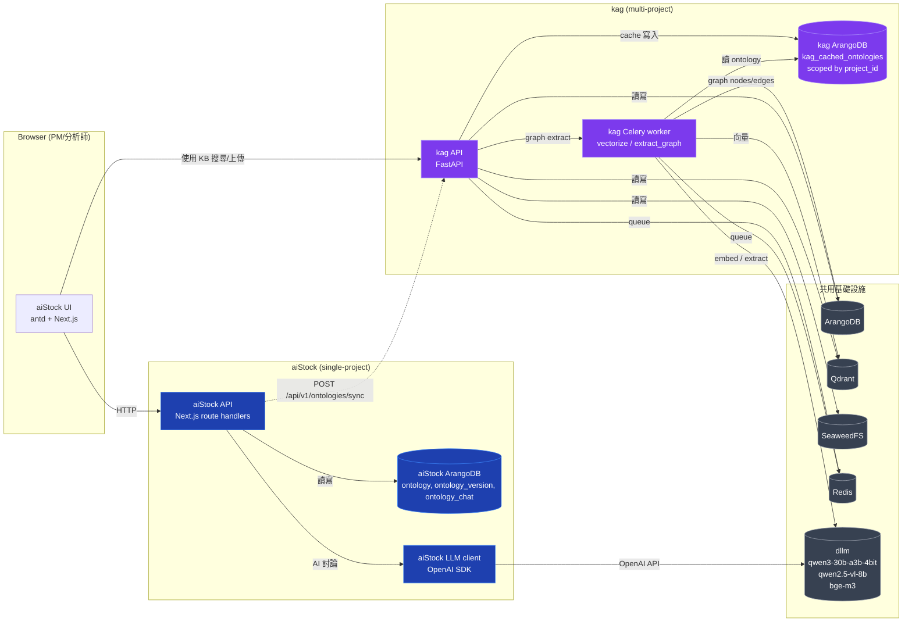
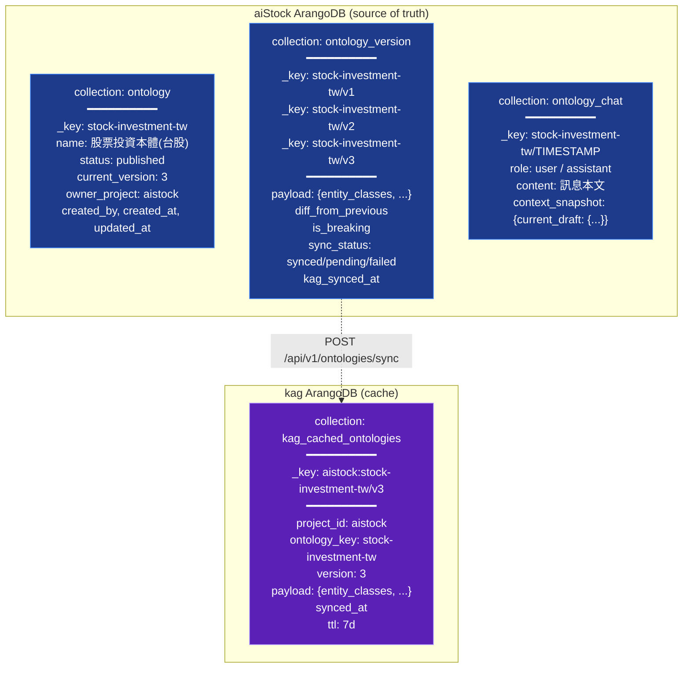
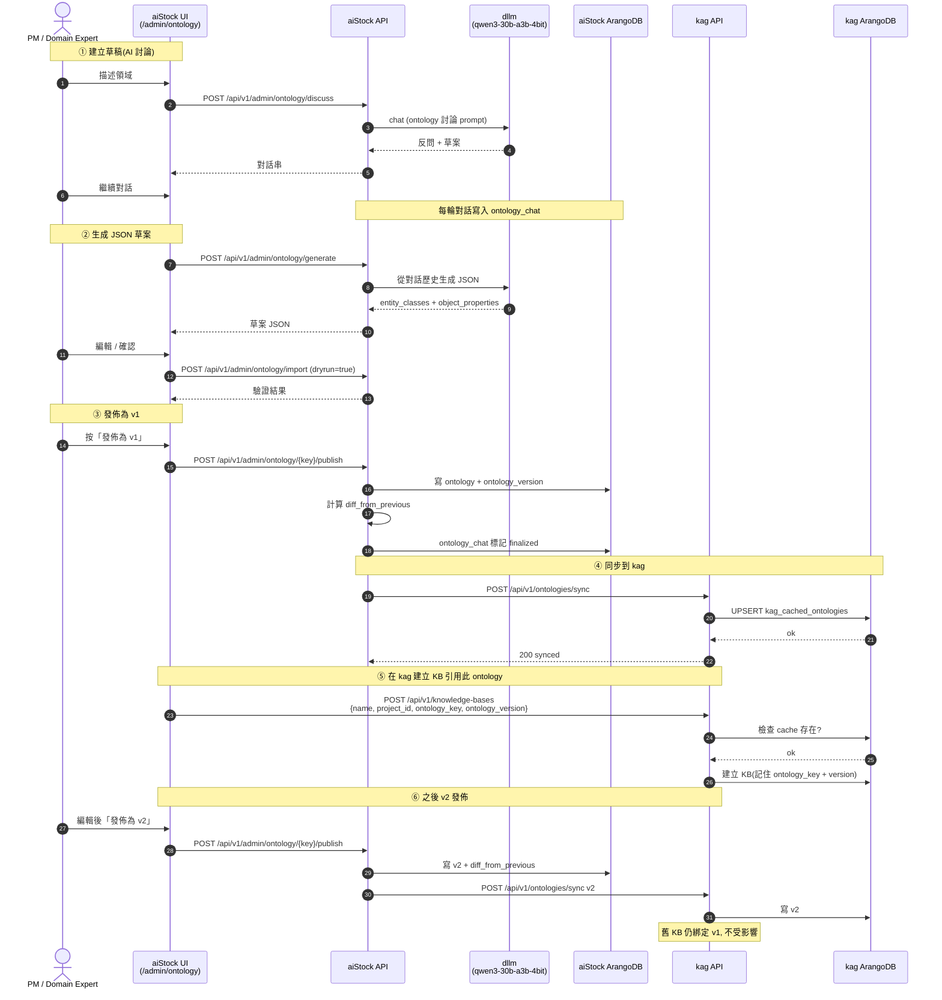
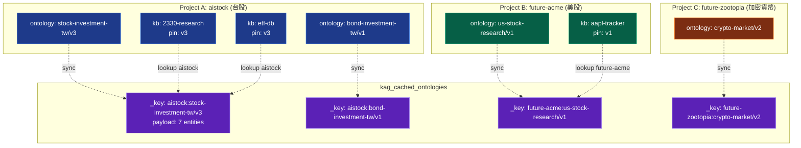

# Ontology 架構規範

> **適用範圍**:aiStock 與 kag 之間的 ontology 資料流、所有權、版本管理、與多專案隔離
> **最後更新**:2026-07-08
> **狀態**:待 PM 確認 → 確認後再生成 `stock-investment-tw-v1.json`
> **相關文件**:`/home/daniel/github/.omo/plans/kag-standalone.md`(kag 端計畫)、`/home/daniel/github/kag/docs/`(kag 規格)

---

## 一、核心結論

- **aiStock 是 ontology 的擁有者**(version control、evolution、UI、審計)
- **kag 是多專案的 RAG 服務**,ontology 在 kag 是 **cache**(按 `project_id` 隔離),不是 source of truth
- AI 討論、Diff、版本發佈在 aiStock 完成後,主動 **sync 給 kag**
- KB 在 kag 透過 `(project_id, ontology_key, version)` 三元組參照快取中的 ontology

---

## 二、系統架構

**關鍵邊界**:
- **虛線** = aiStock 推 ontology 到 kag(cache 寫入)
- **實線** = 一般 API 呼叫
- aiStock 與 kag 共享 ArangoDB / Qdrant / SeaweedFS / Redis(透過 `kag_` 前綴隔離 collection / bucket / key)
- aiStock 與 kag 共享 dllm(同一個 OpenAI 相容 LLM 端點)

---

## 三、Ontology 儲存分佈

**所有權矩陣**:

| 資料 | aiStock | kag | Source of truth |
|---|---|---|---|
| Ontology metadata(name, status, current_version)| 寫 | 不存 | **aiStock** |
| Ontology payload(entity_classes, object_properties)| 寫(發版時)| 寫(cache, TTL 7d)| **aiStock** |
| Ontology 對話歷史 | 寫 | 不存 | **aiStock** |
| AI 討論的 draft schema | 寫 | 不存 | **aiStock** |
| KB metadata | 不存 | 寫 | **kag** |
| KB 內 chunk / vector / graph | 不存 | 寫 | **kag** |
| KB 對 ontology 的引用(key + version)| 不存 | 寫 | **kag** |

---

## 四、Ontology 生命週期(Sequence Diagram)

**發佈原則**:
- v1, v2, v3 都永久保留(immutable)
- KB 在建立時選定 ontology version,**建立後不自動升級**
- v2 為 breaking change(刪除 entity_class、改 domain/range)時,`is_breaking=true`,aiStock UI 跳出警告

---

## 五、kag 多專案隔離

**隔離機制**:
- `_key = {project_id}:{ontology_key}/v{version}` — 用 project_id 當前綴,DB 層級就分開
- KB 也有 `project_id`,graph extraction 時帶 `project_id` 查 ontology cache,查不到就 404
- 跨 project 存取:HTTP 層拒絕(只有 admin token 才能跨 project 操作 ontology 模板)

---

## 六、確認清單

請逐項 confirm 或修正:

| # | 項目 | 預設 |
|---|---|---|
| Q1 | aiStock 是 ontology 擁有者,kag 是 cache consumer | 確認 |
| Q2 | aiStock 推 ontology 到 kag 的 endpoint:`POST /api/v1/ontologies/sync` | 確認 |
| Q3 | kag 的 ontology API 只剩 sync + get(CRUD 全在 aiStock)| 確認 |
| Q4 | kag cache 用 `_key = project_id:key/vN` 形式,按 project 隔離 | 確認 |
| Q5 | aiStock 用 admin token 推 ontology,kag 信任來自 aiStock 的請求 | 確認 |
| Q6 | aiStock 新增 3 collection: `ontology`, `ontology_version`, `ontology_chat` | 確認 |
| Q7 | ontology 對話持久化在 aiStock(不在 kag)| 確認 |
| Q8 | AI 討論 prompt、NER/RE prompt template 由 aiStock 端 LLM 呼叫生成,產物存 aiStock | 確認 |
| Q9 | kag graph extraction 從 cache 載入 ontology,不需要 aiStock 介入 | 確認 |
| Q10 | KB 建立時 `ontology_key + version` 鎖定,KB 生命週期內不自動升級 ontology | 確認 |
| Q11 | KB 升級 ontology 是 aistock 的後台作業(呼叫 kag 的新 API,例如 `POST /api/v1/knowledge-bases/{kb}/rebind-ontology`),不是 ontology sync | 待確認 |
| Q12 | aistock ↔ kag 之間的通訊認證:aiStock 用 `KAG_ADMIN_TOKEN`(管理 ontology 推送),用 per-KB `X-KAG-API-Key`(呼叫 RAG)| 確認 |

---

## 七、確認後的下一步

1. 你逐項 confirm Q1-Q12(可寫 "Q1-Q12 全 OK")
2. 我把 `stock-investment-tw-v1.json` 寫到 `/home/daniel/github/aistock/.docs/ontology/stock-investment-tw-v1.json`
3. 寫對應的人類可讀說明書:`stock-investment-tw-v1.README.md`(含 NER/RE prompt template 範例、use cases)
4. 更新 kag 那邊的 `docs/API.md` 與 `docs/DATA_MODEL.md`,把 ontology 章節對齊到「aiStock-owned, kag-cached」模型

要我等你逐項確認後再做,還是你直接回 "OK 全做" 我就一氣呵成?
