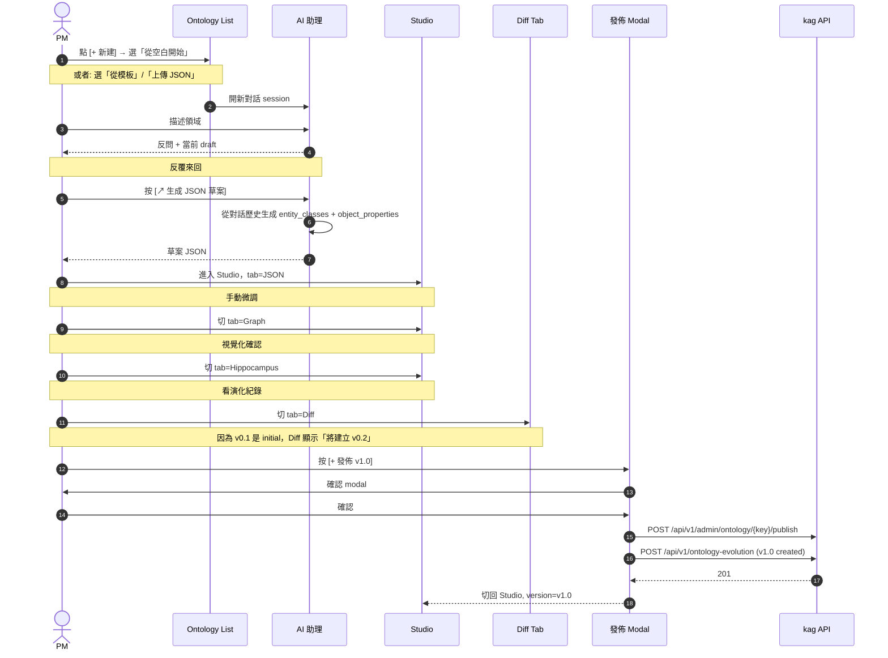
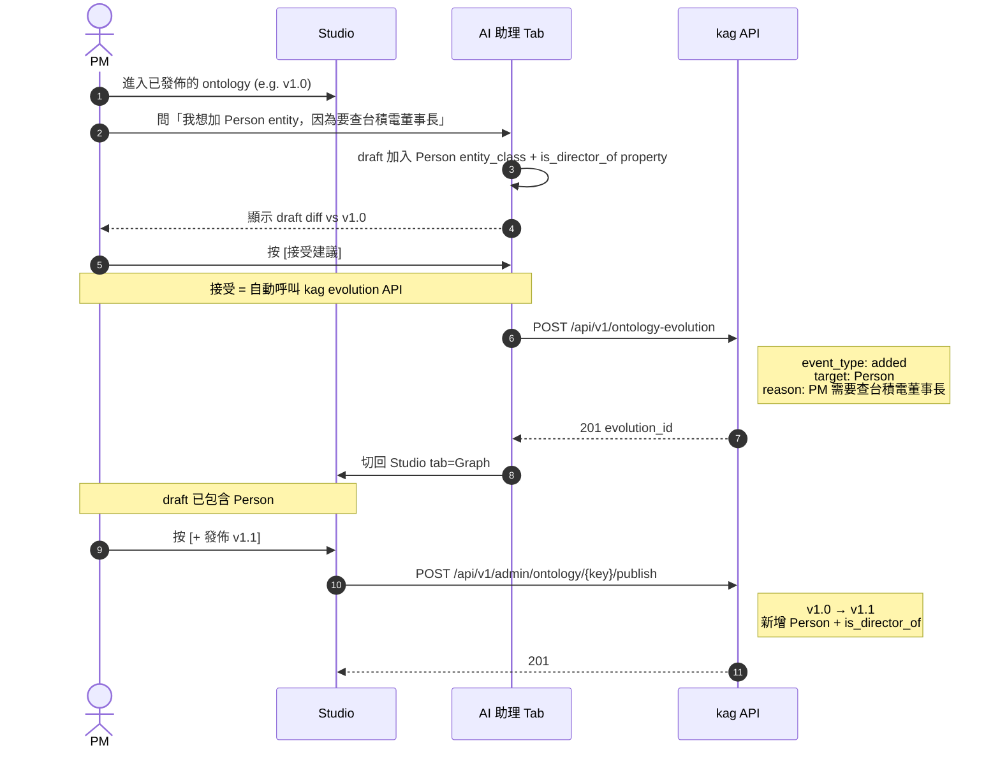

# Ontology 管理 UI 雛形

> **狀態**:v0.1 設計稿（用於討論與迭代，**非最終設計**）
> **最後更新**:2026-07-08
> **設計工具**:ASCII wireframes + 互動流程 (Mermaid)
> **適用**:aiStock 前端，dark mode, antd 設計語言, 1440×900 基準視口
> **配套**:`EVOLUTION_LOG.md`(ontology 內容)、`ONTOLOGY_ARCHITECTURE.md`(系統架構)

## 0. 兩個圖形介面的語意差異

| 頁面 | 節點形狀 | 用途 | 視覺隱喻 |
|---|---|---|---|
| **Ontology Studio** (本檔案) | 矩形 (rect) | 編輯 / 管理本體 schema | 表格、欄位、結構化 |
| **Knowledge Graph View** (kag 上線後) | 圓球 (circle) | 顯示實際抽出的 entities 與 relations | 個體、節點、網絡 |

> G6 v5 支援多種 node type（rect / circle / ellipse / diamond / model-node / image 等）。本頁面 Ontology Studio 用 `rect` 強調「這是 schema 定義」；未來 kag 上線後，實際從文件抽出的 graph 視覺化會用 `circle` 強調「這是資料個體」。

---


## 一、頁面地圖

```
/admin/ontology                                       ← List
  /[key]                                              ← Studio (主控台)
    ?tab=graph          (default)                     ← Graph 視覺化
    ?tab=list                                         ← 純清單檢視
    ?tab=json                                         ← 原始 JSON 編輯
    ?tab=diff&v1=0.1&v2=0.2                          ← 版本差異
    ?tab=extraction                                   ← NER/RE/RT 抽取說明
    ?tab=hippocampus                                  ← 演化歷史 (海馬迴)
    ?tab=ai                                           ← AI 助理討論
  /[key]/publish                                      ← 發佈新版本流程
  /[key]/import                                       ← 上傳 JSON / 從模板建立
```

**重點**:Studio 是 single-page，所有 tab 切換不重新整理（state 保留）。`/publish` 與 `/import` 是從主控台觸發的 modal/drawer，**不**獨立成 page。

---

## 二、Screen 1: Ontology List — `/admin/ontology`

### 用途
入口頁。列出所有 ontology（不限本專案，但 v0.1 只會有 `stock-investment-tw`），支援搜尋與狀態篩選。

### 雛形

```
┌──────────────────────────────────────────────────────────────────────────┐
│ ← aiStock                                                                │
├────┬─────────────────────────────────────────────────────────────────────┤
│    │  Ontology 管理                                       [+ 新建 ▾]    │
│    │ ┌─────────────────────────────────────────────────────────────────┐│
│    │ │ [全部] [活躍 ★] [草稿] [已棄用]    🔍 搜尋...    標籤 ⌄         ││
│    │ ├─────────────────────────────────────────────────────────────────┤│
│    │ │ 名稱                版本  狀態    Entity  KB  最後修改     操作  ││
│    │ ├─────────────────────────────────────────────────────────────────┤│
│    │ │ ⭐ stock-investment-tw  0.1  草稿    4    0   2h ago       ⋯    ││
│    │ │ bond-investment-tw   v1.0  活躍     4    0   1d ago       ⋯    ││
│    │ │ crypto-research       v2   活躍     6    3   3d ago       ⋯    ││
│    │ │ legacy-fund          v3   已棄用  12    0   6mo ago      ⋯    ││
│    │ └─────────────────────────────────────────────────────────────────┘│
│    │                                              1/1 ◀ ▶                  │
└────┴─────────────────────────────────────────────────────────────────────┘
```

### 關鍵設計決策

| 元素 | 決策 | 理由 |
|---|---|---|
| 列順序 | 預設按「最後修改」倒序 | 活躍的 ontology 在最上面 |
| 狀態標籤 | `活躍` / `草稿` / `已棄用` 三種顏色 chip | 視覺一眼分辨 |
| `+ 新建 ▾` | 點開 dropdown：上傳 JSON / 從模板 / 從空白開始 | 之前討論的三入口 |
| `⋯` 動作 | 編輯 / 檢視 / 複製為新 / 匯出 / 刪除（軟刪） | 與 ontology 章節對齊 |
| 空狀態 | 「還沒有 ontology，點 + 新建 開始第一個」 + 引導圖示 | 第一次使用者友善 |
| 大量時 | 不分頁（v0.1 不會超過 10 個 ontology），表格內 scroll | 簡單優先 |

### 假設的 API（給 mockup 用，**還沒定案**）

```
GET    /api/v1/admin/ontology?status=&tag=&q=
POST   /api/v1/admin/ontology/import       (上傳 JSON)
POST   /api/v1/admin/ontology/from-template (從模板)
POST   /api/v1/admin/ontology              (從空白)
```

---

## 三、Screen 2: Ontology Studio — `/admin/ontology/[key]`

### 用途
**主控台**。所有 ontology 操作都在這頁：視覺化、編輯、發佈、討論、查看歷史。一站式。

### 雛形（3 欄 + 底部 tab 列）

```
┌──────────────────────────────────────────────────────────────────────────┐
│ ← Ontology 管理    stock-investment-tw · v0.1 (草稿) ⌄  [+ 發佈 v1.0] ⋯│
├────────────┬────────────────────────────────────────┬───────────────────┤
│ ENTITIES   │                                        │ NODE DETAILS       │
│ (4)        │            (graph canvas)              │                   │
│            │                                        │ ┌─ Company ──────┐ │
│ ▣ Company  │              [Company]                 │ │ 上市公司        │ │
│ ▣ Industry │               /  \                     │ │ stock_code: 2330 │ │
│ ▣ NewsEvt  │              /    \                    │ │ name_zh: 台積電   │ │
│ ▣ FinItem  │    [Industry]    [NewsEvent]           │ │ market: TWSE     │ │
│ ▸ + Add    │             \    /                     │ └─────────────────┘ │
│            │              \  /                      │                   │
│ RELATIONS  │         [FinancialItem]                │ KBs using: 0      │
│ (3)        │                                        │ (尚未綁定到 kag)    │
│            │  拖曳節點編輯關係                       │                   │
│ operates_in│  滾輪縮放                               │ Recent changes    │
│ mentions   │  雙擊節點編輯屬性                       │ ─ v0.1 (initial)   │
│ reported_in│                                        │   today, 14:32    │
│ ▸ + Add    │                                        │   by daniel       │
│            │                                        │                   │
│            ├────────────────────────────────────────┤                   │
│            │ [圖形] [清單] [JSON] [Diff] [抽取]      │                   │
│            │ [Hippocampus] [AI 助理]                │                   │
└────────────┴────────────────────────────────────────┴───────────────────┘
```

### 7 個 tab 對照

| Tab | 內容 | 為什麼需要 |
|---|---|---|
| **圖形** (default) | 上面那張 graph 視覺化 | 主要工作區，看關係 |
| 清單 | 純表格 (entity / property 兩個表)，可排序、可篩選 | 想快速找東西時用 |
| JSON | 原始 ontology JSON + 編輯器（Monaco 或 antd `<Input.TextArea>`）| 進階使用者精修 |
| Diff | 並排顯示兩個版本差異 | 發版前 review |
| 抽取 | 每個 entity / property 配 NER/RE prompt template + 範例 | 理解 LLM 在做什麼 |
| Hippocampus | 時間軸：每個 entity 何時為何被加入 | 為什麼這個 entity 存在 |
| AI 助理 | chat panel：跟 LLM 對話設計新 entity | 主要建立/編輯工具 |

### 3 欄的權重分配

| 欄 | 寬度 | 內容 |
|---|---|---|
| 左 (Tree) | 240px | entity + property 列表，可摺疊 |
| 中 (Canvas) | flex 1 | graph 渲染 / 表格 / JSON / Diff，依 tab 切換 |
| 右 (Details) | 320px | 選中節點的詳細資料 + 版本 + 變更摘要 |

總和 = 1440 - 240(sidebar) - 40(padding) - 240 - 320 = 600px 給中間 canvas。**夠用但緊**。如果要塞 4 欄，畫面會太小。

### 互動細節

- **節點雙擊** = 開啟「編輯 entity」drawer（不離開 Studio）
- **節點右鍵** = 選單：編輯 / 複製 / 刪除 / 設為繼承父類（未來 v2）
- **節點拖到另一節點** = 建立 relation（彈出 relation form：name, domain, range）
- **頂部版本切換器** = dropdown 列出所有版本；切換後中間 canvas 重渲染（**載入該版本 snapshot，不影響現行草稿**）
- **`+ 發佈 v1.0` 按鈕** = 開啟發佈確認 modal（顯示將建立的 version 號、是否有 breaking change、影響幾個 KB）

---

## 四、Screen 3: AI 助理 Tab（海馬迴的入口之一）

### 用途
跟 LLM 對話，討論 ontology 應該有哪些 entity / property。對話結果會被存到 `ontology_chat` collection，AI 結論會記錄成 evolution event（透過 `POST /api/v1/ontology-evolution`）。

### 雛形

```
┌──────────────────────────────────────────────────────────────────────────┐
│ ← 回 Studio     AI 助理 — stock-investment-tw    對話 #3  (since 14:30)  │
├──────────────────────────────────────────────────────────────────────────┤
│  ┌───────────────────────┬────────────────────────────────────────────┐│
│  │ 對話歷史 (左)         │  對話區 (右)                                ││
│  │                       │                                            ││
│  │ 📁 stock-investment-tw│  [你] 我想做台股投資 ontology，給散戶看的 ││
│  │   #1 14:00-14:20      │                                            ││
│  │   #2 14:20-14:25      │  [AI] 好的。請問:                          ││
│  │   #3 14:30-現在       │       1. 包含 ETF 嗎？                    ││
│  │                       │       2. 董監事 vs 大股東要分開嗎？        ││
│  │                       │       3. 財報資料要不要包含預測值？         ││
│  │                       │                                            ││
│  │ [+ 開始新對話]        │  [你] 都先不要, 我只想看公司基本資料       ││
│  │                       │                                            ││
│  │                       │  [AI] 了解。當前 draft:                     ││
│  │                       │  ┌────────────────────────────────────┐   ││
│  │                       │  │ entity_classes: [Company, Industry] │   ││
│  │                       │  │ object_properties: []                │   ││
│  │                       │  │ status: 草稿 (2 entity, 0 prop)    │   ││
│  │                       │  └────────────────────────────────────┘   ││
│  │                       │                                            ││
│  │                       │  [提出下一個 entity? ___________________] ││
│  │                       │                                            ││
│  │                       │  [↗ 生成 JSON 草案]  [↻ 重述我的需求]    ││
│  └───────────────────────┴────────────────────────────────────────────┘│
└──────────────────────────────────────────────────────────────────────────┘
```

### 對話流程的 4 種結束方式

| 動作 | 結果 |
|---|---|
| `[↗ 生成 JSON 草案]` | 跳到 JSON tab，把當前 draft 填入，可手動微調後發佈 |
| `[儲存對話]`（隱含）| 對話寫入 `ontology_chat`，AI 結論記錄成 evolution event |
| `[放棄這個對話]` | 對話標記為 `abandoned`，draft 還原到對話前的狀態 |
| 自然結束（關閉 tab）| 對話保留在歷史，draft 保留為「最後討論的版本」 |

### 設計細節

- **Draft 是唯一狀態**：每個 ontology 只有一份「當前 draft」，存於 `ontology._key` 本身的臨時欄位（或者直接從 `ontology_chat` 最新一筆讀出）
- **AI 結論 → 自動 evolution event**：當 LLM 說「我建議加入 Person entity」並且 PM 按「接受」，kag 自動呼叫 `POST /api/v1/ontology-evolution` 記錄「added Person — reason: PM needs to query board members」
- **可重播對話**：把 `ontology_chat` 的歷史整批丟回 LLM，重現當時的決策脈絡

---

## 五、Screen 4: Hippocampus Timeline Tab

### 用途
這是我們新設計的「海馬迴」概念 — **為什麼這個 ontology 長成現在這樣**。每個 entity / property 都有「出生故事」。

### 雛形

```
┌──────────────────────────────────────────────────────────────────────────┐
│ ← 回 Studio    Hippocampus — stock-investment-tw                  🔍    │
├──────────────────────────────────────────────────────────────────────────┤
│  [全部] [added] [modified] [rejected] [discussed]    篩選: v0.1 ▾    │
├──────────────────────────────────────────────────────────────────────────┤
│                                                                          │
│  ●─ 2026-07-08 14:32 ─ daniel — created ontology ─────────────────────── │
│  │                                                                        │
│  │  觸發：PM 提問「台股散戶最常問什麼？」                                  │
│  │  context: { source_type: "user_request" }                             │
│  │                                                                        │
│  ●─ 14:33 ─ daniel — added entity_class: Company ──────────────────────  │
│  │  reason: 「個股辨識是散戶最基本查詢」                                 │
│  │  trigger_question: 「台積電是 2330 對嗎？」                            │
│  │  ↳ [查看對話]                                                       │
│  │                                                                        │
│  ●─ 14:35 ─ daniel — added entity_class: Industry ─────────────────────  │
│  │  reason: 「需要回答產業歸屬與同產業比較」                              │
│  │                                                                        │
│  ●─ 14:36 ─ daniel — added entity_class: NewsEvent ────────────────────  │
│  │                                                                        │
│  ●─ 14:37 ─ daniel — added entity_class: FinancialItem ────────────────  │
│  │                                                                        │
│  ●─ 14:40 ─ daniel — added property: operates_in ──────────────────────  │
│  │  reason: 「最常見的 entity 關係」                                    │
│  │                                                                        │
│  ●─ 14:42 ─ daniel — rejected entity: Person ─────────────────────────  │
│  │  reason: 「v0.1 故意排除，等真實觸發再加」                            │
│  │  expected_trigger: 「PM 問台積電董事長是誰？」                         │
│  │  ↳ [這個決定是暫時的，PM 之後真的問到 Person 時會被加回]              │
│  │                                                                        │
│  ●─ 14:45 ─ daniel — discussed use_case ────────────────────────────────  │
│  │  reason: 「AI 建議加 use case『本益比多少』，但 v0.1 沒 FinancialConcept│
│  │          還回答不出來，記錄為『v0.2 待觸發』」                          │
│  │                                                                        │
│  v0.1 結束                                                                │
└──────────────────────────────────────────────────────────────────────────┘
```

### 為什麼要單獨一個 tab

- **PM 想知道「為什麼有 / 為什麼沒有」X entity**：點開就看到拒絕原因 + 預期觸發
- **新成員 onboarding**：看一遍 hippocampus 就能理解 ontology 的設計哲學
- **AI 助理設計時**：未來 AI 設計 v0.5 時可讀 hippocampus 知道「v0.1 為什麼排除 X」，避免重複辯論
- **未來 v0.5 觸發時**：每個新 entity 的 evolution event 會 append 到時間軸，半年後回看一目了然

### 互動

- **時間軸節點點開** = 顯示完整 context（觸發問題、討論摘要、相關文件 ref）
- **filter** = 按事件類型（added / modified / rejected / discussed）/ 按版本 / 按 entity 名稱
- **可匯出** = 整個 ontology 的 evolution log 下載成 markdown（debug / 交接用）

---

## 六、Screen 5: Diff View Tab

### 用途
發版前 review — 從 v0.1 改到 v0.2 時，**視覺化**顯示改了什麼。breaking change 會被 highlight。

### 雛形（並排 + unified 三窗格）

```
┌──────────────────────────────────────────────────────────────────────────┐
│ ← 回 Studio    Diff — stock-investment-tw    v0.1  vs  v0.2 ▾          │
├──────────────────────────────────────────────────────────────────────────┤
│                          v0.1  ───→  v0.2                                │
│                                                                          │
│  ENTITY CLASSES                                                            │
│  ─────────────                                                            │
│  [Company]              [Company]      unchanged                          │
│  [Industry]             [Industry]     unchanged                          │
│  [NewsEvent]            [NewsEvent]    unchanged                          │
│  [FinancialItem]        [FinancialItem] unchanged                          │
│                          [Person]      ← ADDED                            │
│                                                                          │
│  OBJECT PROPERTIES                                                        │
│  ─────────────────                                                        │
│  [operates_in]          [operates_in]   unchanged                          │
│  [mentions]             [mentions]      unchanged                          │
│  [reported_in]          [reported_in]   unchanged                          │
│  ─ none ─            [is_director_of] ← ADDED                              │
│                                                                          │
│  ⚠ BREAKING CHANGES                                                      │
│  ─────────────────                                                        │
│  ⚠ removed property: newsEvent.priority (no longer in v0.2)              │
│  ⚠ renamed entity_class: NewsEvent → NewsArticle (breaking: existing KB  │
│    referencing NewsEvent will need re-migration)                          │
│                                                                          │
│  IMPACT                                                                   │
│  ──────                                                                   │
│  📊 0 KB currently using v0.1 (safe to ship)                            │
│  📊 0 KB would need migration if removing newsEvent.priority              │
│                                                                          │
│  [✓ 確認發佈為 v0.2]   [← 回去編輯]                                       │
└──────────────────────────────────────────────────────────────────────────┘
```

### 設計細節

- **三窗格 vs 並排**：預設並排（兩個版本上下排列），可切換 unified diff
- **綠色 = added / 紅色 = removed / 黃色 = modified / 灰色 = unchanged**
- **Breaking change 區塊**永遠在頂部（紅色警示）
- **影響評估**從 kag API 查「還有幾個 KB 用這個 ontology/version」

---

## 七、互動流程（Mermaid）

### A. 建立第一個 ontology 完整流程



### B. 修改現有 ontology（evolution 觸發）



---

## 八、需要你決定的設計議題

### D1. 3 欄 vs 2 欄 + drawer
- **3 欄**（上面那張圖）: 所有資訊同時可見，但 canvas 區窄（~600px 在 1440 視口）
- **2 欄 + drawer**: 左欄（tree + 切換 tabs）+ 中欄（內容），點節點時右側 drawer 滑出詳細資料
- **推薦**: 3 欄，因為 graph 視覺化需要水平空間；detail panel 是常用資訊

### D2. AI 助理 tab vs 獨立 page
- **Tab 內嵌**（現在設計）: 不離開 Studio，context 自動帶著當前 ontology state
- **獨立 page `/[key]/ai`**: 更大空間，但失去「邊看 graph 邊討論」的能力
- **推薦**: tab 內嵌，AI 討論的時候可以同時看 graph

### D3. Graph 渲染技術
- **@antv/g6** (aistock 已用): 力導向佳，學習曲線中
- **react-force-graph** (kag 之前考慮): 較簡單，2D / 3D 都支援
- **Cytoscape.js**: 功能強但大
- **推薦**: g6（已熟悉），但若之後想做 3D graph 再考慮 react-force-graph-3d

### D4. Diff 視覺化
- **並排**（現在設計）: 左 v0.1 / 右 v0.2，diff 高亮
- **unified diff**: 像 git diff 一樣
- **3-pane**: 中間是 v0.1 → v0.2 的轉換，左 v0.1 右 v0.2
- **推薦**: 並排，semantic 比較直觀

### D5. Hippocampus 時間軸 vs 列表
- **時間軸**（現在設計）: 視覺漂亮，強調「故事性」
- **純列表**: 資訊密度高，scanning 容易
- **推薦**: 時間軸為主，提供「列表模式」切換

### D6. 一個 ontology 多個「草稿」是否並行
- **單一 draft**（現在設計）: 一次只能編輯一份
- **多 draft**: 可以「為某個新版本先草擬」，主版本不受影響
- **推薦**: v0.1 單一 draft，未來需要再加

### D7. v0.1 要不要直接做 wireframe → code？
- **先 wireframe → 確認 → code**: 慢但穩
- **邊 wireframe 邊 code**: 快但要回頭改
- **推薦**: 先把這份 wireframe 確認（特別是 D1-D6），然後一次到 v0.1 functional code

---

## 九、v0.1 功能範圍（從 mockup 切到 functional code）

**Day 1-2 先做**:
- [ ] Screen 1 (Ontology List) — antd `<Table>` + filter
- [ ] Screen 2 Studio shell (3 欄 layout) + tab 切換
- [ ] Screen 2 預設 tab (Graph) — 假資料渲染（G6 node 4 個, edge 3 條）

**Day 3-4 再做**:
- [ ] Screen 2 其他 tab (List, JSON) — antd `<Table>` + `<Input.TextArea>`
- [ ] Screen 4 Hippocampus — 假資料時間軸

**Day 5+ 之後**:
- [ ] Screen 3 AI 助理 (需要 aistock LLM client 先就緒)
- [ ] Screen 5 Diff
- [ ] 任何 tab 接真 API

**不進 v0.1 範圍**:
- 拖曳節點建立 relation (改為 form-based add)
- 雙擊節點 inline edit (改為 drawer edit)
- Real-time collaboration
- 模板選擇流程

---

## 十、相關檔案

| 檔案 | 用途 |
|---|---|
| `/home/daniel/github/aistock/.docs/ontology/ONTOLOGY_ARCHITECTURE.md` | 系統架構（4 張 Mermaid 圖）|
| `/home/daniel/github/aistock/.docs/ontology/stock-investment-tw-v0.1.json` | ontology v0.1 內容 |
| `/home/daniel/github/aistock/.docs/ontology/EVOLUTION_LOG.md` | 演化日誌（人讀）|
| `/home/daniel/github/kag/docs/API.md` | 對應的 kag API（hippocampus endpoint 規格）|
| `/home/daniel/github/kag/docs/DATA_MODEL.md` | 對應的 kag 資料模型 |
