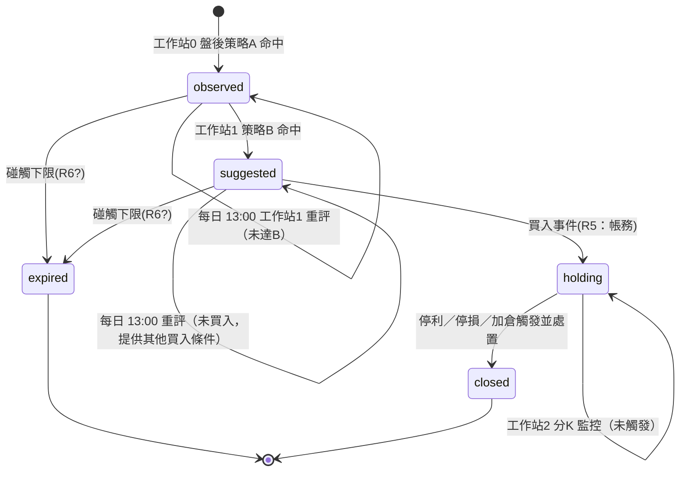

# 需求定位：工作站（Workstation）— 多階段選股／監控管線

> 狀態：**需求已收斂（P0–P2 定案），尚未進入實作**
> 日期：2026-10-27
> 關聯 hermes：`req-aistock-workstation`、`req-aistock-accounting-model`、`aistock-strategy-workspace`、`fubon-migration-status`
> 關聯 skill：`需求`（graph-guided requirements）
> 前置文件：`.docs/accounting/REQUIREMENTS.md`（帳務先行）、`.docs/dashboard-taiex-10m.md`（指數分K 端點與時段護欄）

---

## 1. 需求概述與關鍵面向

**核心動機**：把既有的「單階段策略」升級為**可編排的多階段工作站**——從盤後選股 → 盤中複選 → 持倉監控，形成閉環。

**使用者的場景**：
- **工作站0**：每天盤後依「策略A」（特定搜索條件）命中者進入 **觀察清單**，發送 LINE OA。
- **工作站1**：以工作站0 的觀察清單為輸入，做「策略B」第二級觀察，**每天 13:00** 檢查，命中者進入 **購買建議清單**。
- **工作站2**：若**已買入**，進入 **分K 嚴密監控**（設定停利／停損／加倉條件），命中則發 LINE 提示。
- 進入第二級清單但**未買入** → 持續觀察，仍每天 13:00 提供是否有其他買入條件；否 則**碰觸下限** → 提出名單並**做成記錄**。
- 每個工作站有：**搜索範圍、監控頻率、監控目標**；搜索／觀察／停利停損條件皆可設置。

**關鍵面向（4）**：
1. **清單（List）成為一等公民** — 階段間以清單串接。
2. **每檔股票的狀態機** — 觀察 → 建議 → 持倉 → 結案。
3. **階段依賴的編排** — 工作站0→1→2 的順序與資料新鮮度。
4. **持倉** — 工作站2 的前置（已由「帳務先行」承接）。

---

## 2. 已收斂決策

| # | 決策點 | 決策 | 理由 |
|---|---|---|---|
| 1 | 順序 | **帳務先行**，工作站後做 | 帳務不依賴 G3 爭議；工作站2 需要持倉 |
| 2 | 通知 | **LINE OA 延後** | 使用者指示（本階段不做） |
| 3 | 工作站2 對帳務 | **唯讀**，讀 `positions.avg_cost/shares` 算停利停損 | 帳務是持倉真相來源 |
| 4 | 工作站綁帳戶 | 一個工作站可指定 `account_id`（paper 試跑 / real 實戰） | 帳務 `kind` 設計的附帶好處 |
| 5 | 引擎 | **不新造引擎**，複用既有 conditions DSL + `evaluate_stock`/`_scan` | 既有策略引擎已成熟 |
| 6 | **工作站實體** | **新增 `workstations` 集合**（不擴充 `strategies`） | 文件預設；策略與工作站職責分離 |
| 7 | **G3 盤中輪詢** | **放寬：工作站（階段1/2）允許盤中輪詢**（決策「全面」）；運作限制：僅交易時段、範圍限工作站清單、頻率有界 | 使用者決策 |
| 8 | **清單模型** | `lists` 集合 + 新增 `list:<id>` scope | 見 §6.1 |
| 9 | **狀態機 / 碰觸下限** | `observed / suggested / holding / closed / expired`；下限＝見 §5.1 | 見 §5 |
| 10 | 買入事件來源 | **帳務手動輸入**（先）；schema 對對帳單／券商 API 相容 | 使用者授權建議 |
| 11 | 停利／停損／加倉表達式 | **擴充條件 DSL**：OR 群組 + per-condition action + 相對成本運算元 | 複用既有引擎 |
| 12 | 管線編排 | **APScheduler cron + 新鮮度護欄**（先）；必要時才搬 Airflow DAG | 最小改動 |
| 13 | 工作站 template/instance | **instance**（每站一列，`stage` 標 0/1/2） | 未來可開多站 |
| 14 | 命名 | 新 UI＝「工作站」；既有 `strategy-workspace` 維持「策略」 | 避免大改 |
| 15 | 通知 | 僅定義介面，LINE 延後 | 使用者先前指示 |

---

## 3. 圖譜摘要（影響模組）

### 3.1 既有資產（可複用）
| 模組 | 角色 |
|---|---|
| `backend/src/strategy.py` | conditions DSL（`metric/op/value/tf`）、`INDICATOR_CATALOG`（~66 metric）、`evaluate_stock`、`_scan`（**AND-only**） |
| `backend/src/routers/strategy.py` | `/strategy/screen`、`/ai-screen`、`/generate-script` 等；`_resolve_scope`、`PRESET_STRATEGIES` |
| `backend/src/routers/strategies.py` + `services/strategy_store.py` | 策略 CRUD（`strategies`：name/description/conditions/source） |
| `backend/src/services/strategy_run_store.py` | 執行記錄（`strategy_runs`：conditions/hits/scope/source/executed_at/count/action） |
| `backend/src/services/hit_persistence.py` | 命中記錄（`strategy_hits`：scan_id+stock_id、read、30d TTL） |
| `backend/src/scheduler.py` | APScheduler + `schedule_jobs`（cron，Asia/Taipei）；job type `strategy_screen` |
| `backend/src/celery_app.py` | 重任務（Celery） |
| `frontend/src/components/strategy-workspace.tsx` | 策略庫＋執行記錄 UI（P0–P4 完成） |
| `frontend/src/lib/market-hours.ts` | 交易時段護欄（**盤中輪詢關鍵**） |
| `.docs/accounting/REQUIREMENTS.md` | 帳務（`accounts/ledger/positions/corporate_actions`） |
| `backend/src/simulation.py` | 台股成本／稅費／損益數學（供帳務抽取） |

### 3.2 必須新造
1. **清單實體**（`lists`）＋ **`list:<id>` scope**。
2. **每檔股票生命週期狀態機**。
3. **工作站實體**（或擴充 `strategies`）。
4. **階段依賴編排**（DAG 或新鮮度護欄）。
5. **DSL 擴充**：OR 群組、per-condition action、**相對持倉成本**運算元。
6. **分K 監控迴圈**（盤中、市場時段 gated）。
7. **通知子系統**（LINE OA）— 延後。

### 3.3 保持獨立（不整合）
`backtest.py`（比例制）、`tasks/tx_rl_env.py`（期貨 RL）、`auction`（競拍）。

---

## 4. 矛盾與風險

> **R1／R2／R3 的方向已定案**（見 §2 決策 7／9／8）；仍待實作。R4–R9 待處理。

| # | 等級 | 問題 | 說明 |
|---|---|---|---|
| **R1** | 🔴 | **G3 vs 工作站1/2** | `G3` 禁盤中即時輪詢。工作站1（13:00）與工作站2（分K）皆為盤中。**不可假設**既有「指數 10 分K」例外涵蓋它們（那是 display-only、不產生決策）——需**另立明確政策**。資料現實：**富邦分K 回溯淺、往後累積**；yfinance 1m 僅 7 天 → 工作站2 在資料累積足夠前不可行。13:00 用 15m bar 另有「當根未收完」問題。 |
| **R2** | 🔴 | **DSL 是 AND-only** | `_scan` 只保留全數通過；腳本語言明文不支援 `or`/`not`。但「停利 OR 停損 OR 加倉」是互斥觸發，本質 OR；且為**相對持倉成本**條件（現有 DSL 無「成本」運算元）。需引擎層擴充。 |
| **R3** | 🔴 | **scope 無法吃清單** | `_resolve_scope` 只有 `all / watchlist / sector:<industry>`。工作站1 無法以工作站0 的輸出為輸入。 |
| **R4** | 🟠 | **排程無依賴（無 DAG）** | APScheduler 各 job 獨立；stage1 可能讀到過期／空的 stage0 清單。 |
| **R5** | 🟠 | **「已買入」事件無來源** | 工作站2 靠「已買入」觸發，但無任何機制記錄買入 → 由帳務承接（手動／對帳單／券商 API）。 |
| **R6** | 🟠 | **「碰觸下限」未定義** | 價格破底？觀察到期？連 N 日不符？不明確則無法實作「出場並記錄」。 |
| **R7** | 🟠 | **引擎無測試保護** | 策略引擎核心（`evaluate_stock`/`_scan`）無 covering tests → 疊 OR＋狀態機迴歸風險高。 |
| **R8** | 🟡 | **成本與限流** | 工作站0 盤後掃全市場可；工作站2 每分鐘掃持倉 → 受富邦 **60 req/min**、TWSE **3 req/5s（G7）** 限制，範圍須限縮。 |
| **R9** | 🟡 | **命名衝突** | 已有 `strategy-workspace.tsx`（策略工作區）。「工作站」需與其區隔。 |

---

## 5. 每檔股票的生命週期狀態機（核心，未定義）



**必須定義**：
1. **狀態集合**（`observed / suggested / holding / closed / expired` 是否完整？）。
2. **每個轉移的權威寫入者**（策略掃描？帳務？人工？）。
3. **同檔重複命中的去重**（工作站0 連日命中：加入 or 整份清單重算？）。
4. **狀態粒度**：per-`(工作站, 股票)` 還是 per-股票？
5. **進出場原因的可稽核記錄**。

### 5.1 「碰觸下限」＝出場（expire）條件（預設，可調）

任一成立即轉為 `expired`：

1. **價格下限**：收盤 < 該 membership 的 `base_price` × (1 − 10%)。
   （`base_price` = 進入該狀態當日的收盤價，存於 membership。）
2. **時間下限**：`observed` / `suggested` 連續 **N = 20 個交易日**未晉升 → 到期。
3. **條件失效**：工作站 A 的核心條件不再成立（例如 `ma_bull` 由 true 轉 false）。

出場時寫入：membership `state=expired`（記 `reason`、`exit_price`、`exited_at`），
並落一筆 `list_events`（可稽核）＝「做成記錄」。

---

## 6. 建議設計方向（定案方向）

### 6.1 資料模型（定案方向）
```
workstations  { _key, name, stage(0|1|2), source_strategy_id|conditions,
                scope, cron, targets, account_id, enabled }
lists         { _key, name, kind(observed|suggested), source_run_id,
                generated_at,
                members:[{ stock_id, state, since, base_price, expires_at,
                           reason, score }] }
list_events   { _key, list_id, stock_id, from_state, to_state, at, reason, price }
# scope: "all" | "watchlist" | "sector:<industry>" | "list:<list_id>"（新增）
# 持倉／帳務：見 .docs/accounting/REQUIREMENTS.md（accounts/ledger/positions）
```

### 6.2 編排歸屬
| 階段 | 機制 | 理由 |
|---|---|---|
| 工作站0（盤後） | APScheduler cron（複用 `strategy_screen`） | 盤後、現有機制足 |
| 工作站1（13:00） | APScheduler cron + **依賴護欄**（檢查 stage0 清單新鮮度） | 簡單；或搬 Airflow DAG |
| 工作站2（分K） | 盤中 **market-hours-gated** 迴圈（複用 `market-hours.ts` 模式）＋ Celery beat | 純 cron 不足；受 R1 資料限制 |

### 6.3 實作順序（與「帳務先行」一致）
`帳務(A) → 清單實體 + list scope(B) → 工作站實體 + 狀態機(C) → DSL 擴充 OR/相對成本(D) → 分K 監控 + G3 政策(E) → 通知(F，延後)`

### 6.4 近期已解鎖
- 帳務 spec 完成 → 工作站2 的持倉來源就緒。
- 指數 10 分K 端點（`/market/taiex/bars`）＋ `market-hours.ts` → **工作站1/2 的盤中資料路徑與時段護欄已有雛形可複用**。

---

## 7. 決策狀態

> **P0–P2 皆已定案** — 見 §2 決策 6–15。本節保留原始選項供回溯。

| 優先 | 問題 | 選項 |
|---|---|---|
| **P0** | 工作站＝新實體 or 擴充策略？ | (a) 新 `workstations` (b) `strategies` 加欄位 (c) 編排層引用多策略 |
| **P0** | G3 政策：允許工作站1/2 盤中輪詢嗎？ | (a) 全面放寬 (b) 只放寬「觀察／持倉清單」小範圍 (c) 維持盤後（13:00 改隔日／盤後） |
| **P0** | 清單模型 + `list:<id>` scope | 見 §6.1 |
| **P0** | 狀態機 states/transitions + 「碰觸下限」定義 | 見 §5 |
| **P1** | 買入事件來源 | (a) 帳務手動 (b) 對帳單匯入 (c) 券商 API（富邦） |
| **P1** | 停利／停損／加倉 的表達式 | (a) 擴充 DSL（OR＋成本運算元）(b) 獨立 evaluator |
| **P1** | 管線編排 | (a) cron＋新鮮度護欄 (b) Airflow DAG |
| **P2** | 工作站 template vs instance | 固定三種站台 vs 可開多個同型站 |
| **P2** | 命名（工作站 vs 策略工作區） | — |
| **P2** | 通知管道範圍（LINE 等） | 延後，但需先定義介面 |

---

## 8. 參考

- `.docs/accounting/REQUIREMENTS.md` — 帳務（前置）
- `.docs/dashboard-taiex-10m.md` — 指數分K 端點與 `market-hours` 護欄
- `.docs/simulation-replay.md` — 紙上交易（台股費用／移動平均成本）
- `.omo/plans/schedule-redesign.md` — `schedule_jobs` 設計
- `AGENTS.md` — G1–G17 守則（特別 G3、G7、G9、G16）

---

*相關程式碼：`backend/src/strategy.py`、`backend/src/routers/strategies.py`、`backend/src/services/strategy_*.py`、
`backend/src/services/hit_persistence.py`、`backend/src/scheduler.py`、`frontend/src/components/strategy-workspace.tsx`、
`frontend/src/lib/market-hours.ts`。*
