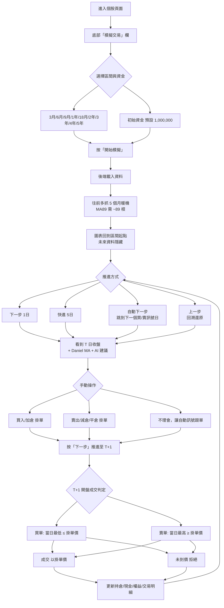
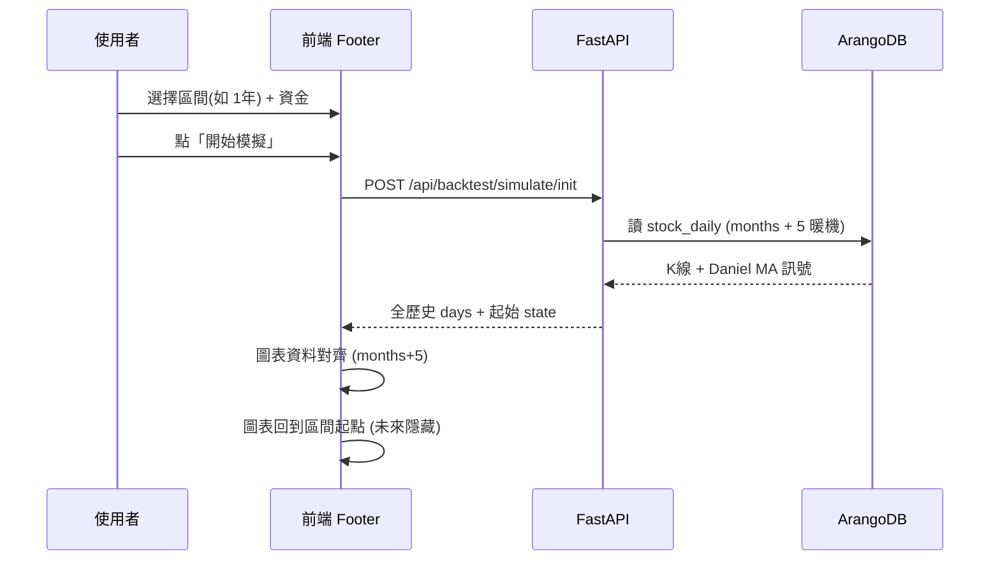
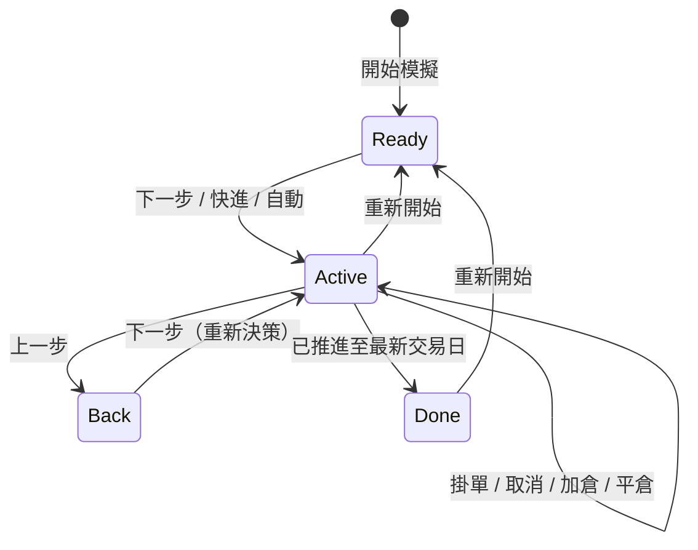
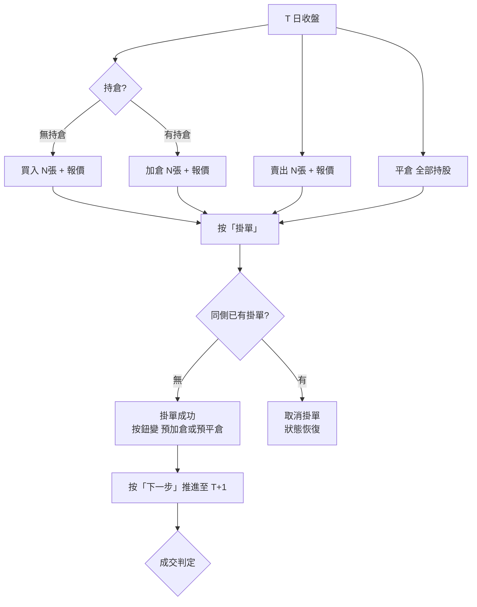
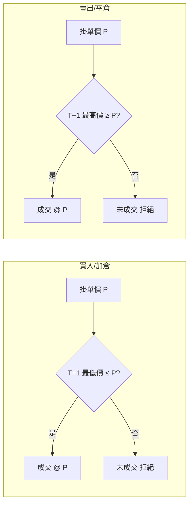
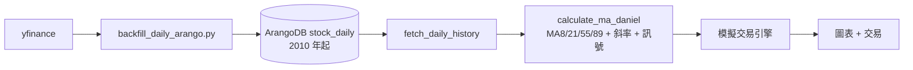

# 模擬交易與重播（Replay & Paper Trading）操作說明

> 台股 K 線重播 + 紙上模擬交易系統。使用者可回到歷史任一交易日，逐步推進，
> 依 Daniel MA 指標與 AI 建議自行決定買賣，體驗「T 收盤確認訊號、T+1 開盤成交」
> 的真實交易節奏，且圖表同步隱藏未來資料（無偷看未來）。

---

## 一、整體流程



---

## 二、啟動流程



**要點**
- 暖機：`WARMUP_MONTHS = 5`（約 110 交易日），確保模擬起點時 MA89 已完整。
- 圖表：`onMonthsChange(months+5)` 讓圖表資料涵蓋暖機期；`replayData` 截斷到當前模擬日，未來 K 線隱藏。

---

## 三、推進與回溯



| 按鈕 | 行為 | 備註 |
|---|---|---|
| **下一步 (1日)** | 推進一個交易日，T 收盤 → T+1 開盤成交 | 核心節奏 |
| **快進 5日** | 一次推進 5 天 | |
| **自動下一步** | 跳到下一個出現 **買/賣訊號** 的交易日 | `stop_on_signal` |
| **上一步** | 退回上一個交易日，還原當時持倉/現金/掛單 | 歷史快照 |
| **重新開始** | 回到起點，清空所有狀態 | |

**上一步的歷史快照**
- 每次成功推進後，前端保存「推進前的 state + 當日」至記憶體陣列。
- 上一步 = pop 最後一個快照並還原，可連續回退。
- 回退後可重新決策（產生分支模擬）。

---

## 四、下單與成交判定

### 4.1 掛單流程



### 4.2 成交判定（T+1 開盤比對）



**費用計算**
| 項目 | 費率 |
|---|---|
| 買進手續費 | 0.1425% |
| 賣出手續費 | 0.1425% |
| 賣出證交稅 | 0.3% |

**平均成本**
- 首次買入：`(成交價 × 股數 + 手續費) ÷ 股數`
- 加倉：加權平均 = `(舊股數×舊均價 + 新股成本 + 手續費) ÷ 總股數`
- 損益% = `(賣出每股淨額 ÷ 持倉均價 − 1) × 100`（含全部費用）

**資金不足**：掛單張數超過現金時，自動降為最大可負擔股數（避免負現金）。

---

## 五、UI 佈局

```mermaid
flowchart TD
    subgraph Collapsed[折疊列]
        C1[模擬交易 — 股票 · 日期]
        C2[權益 %]
    end

    subgraph Expanded[展開面板]
        E1[控制列]
        E2[持倉單行]
        E3[下單區]
    end

    E1 --> E1a[上一步 下一步 快進5日 自動下一步 重設]
    E1 --> E1b[AI 建議標籤<br/>買入/賣出/續抱/觀望 顏色區分]
    E1 --> E1c[交易明細按鈕]

    E2 --> E2a[現金 / 持股+均價 / 權益 / MA8 / MA21 / 強度 / 成本]

    E3 --> E3a[加倉(或買入) 張數 報價 掛單 = 金額]
    E3 --> E3b[賣出 張數 報價 掛單 = 金額 平倉]
```

### AI 建議
- 每個交易日收盤後顯示操作建議：**買入 / 賣出 / 續抱 / 觀望**（顏色區分）。
- 點擊標籤 → Modal 顯示詳細理由（均線排列、斜率、扣抵、大量區距離、參考價位）。
- AI 僅供參考，操作權在使用者。

### 交易明細
- 點「交易明細」→ 無遮罩浮動視窗（DOM 外部點擊關閉）。
- 顯示：日期 / 操作 / 張數 / 成交價 / 均價 / 累計交易成本。

---

## 六、後端 API

| 端點 | 方法 | 說明 |
|---|---|---|
| `/api/backtest/simulate/init` | POST | 初始化模擬，回傳全歷史 days + 起始 state |
| `/api/backtest/simulate/advance` | POST | 推進 N 天；`stop_on_signal=true` 停在訊號日 |
| `/api/backtest/simulate/order` | POST | 掛單（買/賣 + 報價 + 張數），**不推進** |
| `/api/backtest/simulate/cancel-order` | POST | 取消已掛單 |
| `/api/backtest/run` | POST | 回測（批次驗證策略） |
| `/api/backtest/suggest` | GET | AI 建議策略參數 |

**advance 關鍵參數**
```
manual_order: { action, limit_price?, lots? }   # 手動單優先於自動訊號
stop_on_signal: boolean                          # 停在買/賣訊號日
```

---

## 七、資料與指標



- 日K 自 **2010-01** 起（watchlist 新增股票時異步補齊，`backfill_daily_history` Celery 任務）。
- Daniel MA 計算自 2010 起，暖機期 MA 為 None，之後完整有效。
- 模擬載入資料往前多加 **5 個月**暖機，確保起點指標完整。

---

*相關程式碼：`backend/src/simulation.py`、`backend/src/routers/backtest.py`、
`backend/src/ai_advice.py`、`backend/src/tasks/backfill_daily.py`、
`frontend/src/components/stocks/SimulationFooter.tsx`。*
